<p align="center">
  
</p>

<p align="center">
  
</p>

<p align="center">
  
  
  
  
</p>

## Overview

A Kubernetes monitoring stack defined entirely as manifests: Prometheus for metrics and alert rules, Grafana for dashboards, Alertmanager for routing, kube-state-metrics for cluster state and node-exporter for host metrics. A single script deploys the whole stack.

## Highlights

- Prometheus deployment with scrape configuration and alert rules
- Grafana deployment with provisioned datasources and dashboards
- Alertmanager routing configuration
- kube-state-metrics and node-exporter
- One-command deployment script

## Tech stack

<p align="center">
  
</p>

## Getting started

**Prerequisites:** A Kubernetes cluster and kubectl configured against it.

```bash
chmod +x deploy-all.sh
./deploy-all.sh
kubectl get pods -A
```

## Project structure

```text
prometheus/          deployment, config, alert rules
grafana/             deployment and dashboard provisioning
alertmanager/        deployment and routing config
kube-state-metrics/  cluster metrics
node-exporter/       host metrics
deploy-all.sh        applies every manifest
```

---

<p align="center">
  
</p>

<p align="center">
  Built by <a href="https://github.com/Skander-Bardaoui"><b>Skander Bardaoui</b></a> ·
  <a href="https://skander-bardaoui.netlify.app/">Portfolio</a> ·
  <a href="https://github.com/Skander-Bardaoui?tab=repositories">All repositories</a>
</p>
